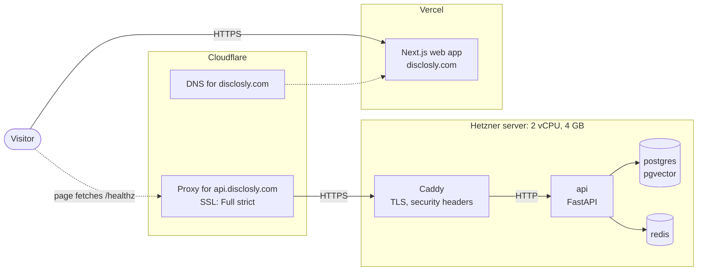
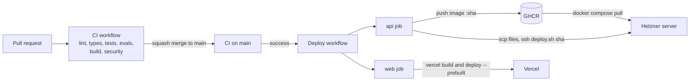
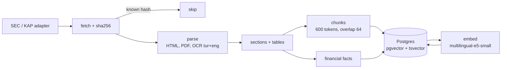
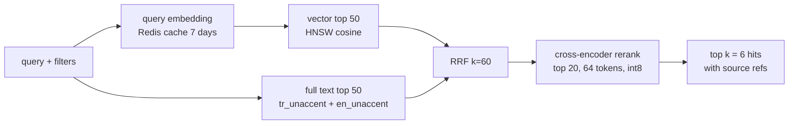

# Architecture

Phase 1 has no product features. It ships the delivery path that later phases use: a web
page, an API with its data stores, and the pipeline that deploys both. The decisions
behind it are in [ADR 0001](adr/0001-walking-skeleton-delivery.md) and in
`specs/001-walking-skeleton/research.md`.

## Runtime

A request for the web page goes to Vercel. The DNS records for the apex and `www` are not
proxied, and `www` redirects to the apex. The page's JavaScript calls
`https://api.disclosly.com/healthz` straight from the browser, so the API needs CORS for
`https://disclosly.com`.

A request for the API goes through the Cloudflare proxy to Caddy on the server. Cloudflare checks
Caddy's Let's Encrypt certificate (Full strict mode), so traffic is encrypted on both legs.
Caddy redirects HTTP to HTTPS and forwards the request to `api:8000` on the Compose network.
Only Caddy publishes ports. Postgres and Redis are reachable from the `api` container only.

The API has three endpoints in this phase:

- `/healthz` answers that the process is alive and reports the deployed commit SHA. It does no
  I/O, so it stays fast when a dependency is down.
- `/readyz` checks Postgres and Redis, with a 2 s timeout for each.
- `/metrics` exposes Prometheus metrics.

Every container has a memory limit and `restart: unless-stopped`, so the stack comes back on its
own after a reboot.

## Deploy

1. Every pull request runs the `CI` workflow. Branch protection on `main` blocks the merge until
   every job is green.
2. After a squash merge, `CI` runs again on `main`. The `Deploy` workflow starts only when that
   run succeeds (`workflow_run`). Deploys are serialized: a second merge waits for the first
   deploy to finish.
3. The `api` job builds the image with `APP_VERSION=<sha>` and pushes it to GHCR. It then copies
   `docker-compose.yml`, `Caddyfile` and `deploy.sh` to the server and runs `deploy.sh <sha>` over
   SSH. The script pulls the image, runs migrations, swaps the `api` container, and waits up to
   60 s for `/healthz` to report the new SHA. If that does not happen, it restores the previous
   tag and the job fails.
4. The `web` job runs independently. It builds the site with the Vercel CLI and publishes the
   prebuilt output. Vercel's own Git deploys are switched off, so a red CI never reaches
   production.

## Infrastructure as code

Terraform in `infra/terraform/` manages the server, its firewall (inbound 22, 80 and 443 only),
the SSH key, the Cloudflare DNS records and the zone's SSL settings. It runs from the
maintainer's laptop with local state. `cloud-init.yaml` prepares a new server: Docker, the
`deploy` user, swap, SSH hardening and automatic security updates. The runbook covers
provisioning, the first deploy and day-to-day operations.

## Data and retrieval (Phase 2)

Phase 2 adds the corpus and hybrid search. The spec is in `specs/002-data-retrieval/`, the
configuration choices in [ADR 0002](adr/0002-retrieval-configuration.md).

### Data sources

| Source | Companies | Documents | Language |
|---|---|---|---|
| SEC EDGAR | 20 US tickers (`ingestion/companies.yaml`) | 10-K, 10-Q, `companyfacts` XBRL | en |
| KAP | top 20 BIST 30 members by market cap | financial statements, annual and interim reports, material events | tr |

The window is the last two years. SEC is limited to 5 requests per second with a contact
`User-Agent`, KAP to 1 request per second.

### Ingestion pipeline

The `worker` container (arq, `max_jobs = 1`, 768 MiB) runs ingestion nightly at 02:30 UTC and
embeds new chunks in small batches. A document is skipped when its `(source_url, content_hash)`
already exists; a new hash at a known URL supersedes the old row. A failed document is marked
`failed` and retried on the next run, and the run continues. Raw files are deleted after
parsing. The first bulk embedding ran on the maintainer's laptop through an SSH tunnel (runbook,
"Corpus ingestion").

### Retrieval flow

Both paths apply the same filters (ticker, period range, document type, section, language,
chunker version) in SQL, so no hit can break a filter. Every hit carries its document, section,
page and source URL for citation.
